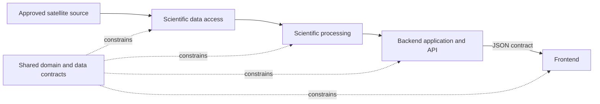

# Architecture

## Current implementation

The repository is a monorepo with a minimal React/TypeScript frontend and a Python package. The Python package now has a synthetic-tested, per-acquisition Sentinel-2 NDVI processor and series-result assembler in `science/vegetation/`; it has no API, provider adapter, data access, or real-data processing. [The first-workflow contract](DATA_CONTRACTS.md) and [domain model](DOMAIN_MODEL.md) specify shared meanings; they do not imply a complete time-series service.

## First workflow

The proposed first scientific workflow is to explore one verified agricultural parcel's Sentinel-2 NDVI history. It is gated on finding and inspecting a suitable parcel source and product coverage. It reports an indicator and its provenance; it does not classify stress or infer cause. See [the contracts](DATA_CONTRACTS.md) and [integration guidelines](INTEGRATION_GUIDELINES.md).

## Responsibilities and ownership

| Area | Owns | Depends on | Must not own |
|---|---|---|---|
| `frontend/` | User interactions, map/chart presentation, frontend types, API client, loading/error/empty states | The published JSON contract and backend responses | Satellite product loading, raster processing, or scientific calculations |
| Backend API/application | Request validation, orchestration, serialization, HTTP errors, API exposure | Domain contract and public scientific processing interface | Duplicated NDVI/quality algorithms, browser presentation, or provider-specific raster parsing |
| Scientific data access | Reading approved product assets and source metadata; mapping product-specific metadata/quality into explicit inputs | Approved source/product definitions and documented file formats | HTTP endpoints, frontend types, or UI behavior |
| Scientific processing | Applying the approved quality policy, calculating NDVI, parcel-level valid-pixel aggregation, and processing provenance | Explicit arrays/masks/geometries, domain concepts, focused geospatial libraries | FastAPI, API schemas, frontend code, or hidden downloads |
| Domain concepts | Stable meanings and relationships shared across application and science | Standard language types and documented semantics | Frameworks, providers, storage schemas, or rendering |

The table describes target responsibilities. The repository currently has the frontend shell and the focused scientific processor described in [SCIENCE_PROCESSING.md](SCIENCE_PROCESSING.md); the API, product access, and workflow orchestration are not implemented.

## Data and dependency flow

Permitted code dependencies are one-way: backend application/API code may call the scientific public interface; scientific access and processing must not import backend HTTP schemas or frontend code; frontend consumes the API contract and must not import Python implementation details. Provider adapters supply product data and metadata to processing. Processing returns typed results and provenance to backend orchestration, which serializes them into the API representation. It must not reimplement the scientific algorithms.

## Responsibility decisions for the first workflow

- **Load satellite products:** scientific data-access adapter, only after source/product and access are approved.
- **Read source quality layers:** data-access adapter preserves the product's original flags and metadata.
- **Apply quality masks:** scientific processing applies the documented product-specific policy to provided masks; it does not invent missing QA information.
- **Calculate NDVI:** scientific processing, using the selected product's appropriate reflectance bands and documented processing level.
- **Aggregate valid pixels within a parcel:** scientific processing, after a method for geometry, CRS, nodata, and statistic has been approved and validated.
- **Create scientific provenance:** data access records source/product/acquisition references; processing records method, version, parameters, and quality treatment; backend carries these into the response.
- **Expose results through API:** backend validates the selection, orchestrates the science call, maps errors, and serializes the documented response.
- **Format results for users:** frontend formats the returned values for map/chart/table presentation without recalculating them.

## API and module timing

FastAPI remains the selected framework when a concrete API is approved. Do not add routes or create empty API/domain/science/data directories in advance. Use [DATA_CONTRACTS.md](DATA_CONTRACTS.md) as the current semantic contract. Before parallel API implementation, choose a single machine-readable contract artifact (likely OpenAPI for HTTP) and derive or validate consumer types and fixtures from it. No endpoint paths are fixed here.

## Data flow and storage

Approved source → acquisition/access → inspection → documented scientific processing → traceable parcel-level output → backend API/interface → frontend. Keep raw products, intermediates, and derived outputs distinct. Large source data does not belong in Git or browser downloads. The storage/deployment mechanism is deferred until data volume and hosting requirements are known.

## Dependency policy

Use the smallest dependencies that support an approved task. Pin resolved versions in lockfiles. Avoid PostGIS, cloud services, distributed processing, and machine-learning infrastructure until requirements justify them.
