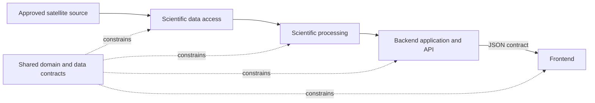

# Architecture

## Current implementation

The repository is a monorepo with a minimal React/TypeScript frontend and a Python package. The Python package has a synthetic-tested Sentinel-2 NDVI processor and series assembler, public STAC/COG readers for one Sentinel-2 L2A and one Sentinel-1 RTC acquisition, and a local-file NISAR GCOV reader validated against an actual product. The actual NISAR product yields four excluded/null parcel measurements because every candidate pixel fails its source focus mask. These are reproducible scientific command-line workflows, not an API or interactive application. See [the result report](FIRST_REAL_MULTISENSOR_RESULT.md) and [NISAR validation](NISAR_GCOV_PRODUCT_VALIDATION.md). [`contracts/multisensor-response.schema.json`](../contracts/multisensor-response.schema.json) is now the canonical API response shape; the domain model documents its concepts.

## First integration workflow

The first user-facing workflow is to select a source-backed parcel, view its geometry on a map, request observations for an inclusive date range and selected missions, and inspect each acquisition's sensor-specific measurements, quality, coverage, provenance, and limitations. The response may include Sentinel-2 NDVI, Sentinel-1 C-band VV/VH, and NISAR L-band GCOV as separate quantities/channels. No common numeric scale or cross-sensor statistic is implied. See the [multisensor handoff](IMPLEMENTATION_GUIDE.md).

## Responsibilities and ownership

| Area | Owns | Depends on | Must not own |
|---|---|---|---|
| `frontend/` | User interactions, map/chart presentation, frontend types, API client, loading/error/empty states | The published JSON contract and backend responses | Satellite product loading, raster processing, or scientific calculations |
| Backend API/application | Request validation, orchestration, serialization, HTTP errors, API exposure | Domain contract and public scientific processing interface | Duplicated NDVI/quality algorithms, browser presentation, or provider-specific raster parsing |
| Scientific data access | Reading approved product assets and source metadata; mapping product-specific metadata/quality into explicit inputs | Approved source/product definitions and documented file formats | HTTP endpoints, frontend types, or UI behavior |
| Scientific processing | Applying the approved quality policy, calculating NDVI, parcel-level valid-pixel aggregation, and processing provenance | Explicit arrays/masks/geometries, domain concepts, focused geospatial libraries | FastAPI, API schemas, frontend code, or hidden downloads |
| Domain concepts | Stable meanings and relationships shared across application and science | Standard language types and documented semantics | Frameworks, providers, storage schemas, or rendering |

The table describes target responsibilities. The repository currently has the frontend shell and the focused scientific processor described in [SCIENCE_PROCESSING.md](SCIENCE_PROCESSING.md); the API, product access, and workflow orchestration are not implemented.

## Data and dependency flow

Permitted code dependencies are one-way: backend application/API code may call the scientific public interface; scientific access and processing must not import backend HTTP schemas or frontend code; frontend consumes the API contract and must not import Python implementation details. Provider adapters supply product data and metadata to processing. Processing returns typed results and provenance to backend orchestration, which serializes them into the API representation. It must not reimplement the scientific algorithms.

## Responsibility decisions for the first workflow

- **Load satellite products:** scientific data-access adapter, only after source/product and access are approved.
- **Read source quality layers:** data-access adapter preserves the product's original flags and metadata.
- **Apply quality masks:** scientific processing applies the documented product-specific policy to provided masks; it does not invent missing QA information.
- **Calculate NDVI:** scientific processing, using the selected product's appropriate reflectance bands and documented processing level.
- **Aggregate valid pixels within a parcel:** scientific processing, after a method for geometry, CRS, nodata, and statistic has been approved and validated.
- **Create scientific provenance:** data access records source/product/acquisition references; processing records method, version, parameters, and quality treatment; backend carries these into the response.
- **Expose results through API:** backend validates the selection, orchestrates the science call, maps errors, and serializes the documented response.
- **Format results for users:** frontend formats the returned values for map/chart/table presentation without recalculating them.

## API and module timing

FastAPI remains the selected framework. The machine-readable response contract and proposed minimum API surface are documented in [IMPLEMENTATION_GUIDE.md](IMPLEMENTATION_GUIDE.md). Routes are still unimplemented; add only the parcel GeoJSON and parcel observations operations needed by that workflow. Do not create speculative services or duplicate the schema in parallel documents.

## Data flow and storage

Approved source → acquisition/access → inspection → documented scientific processing → traceable parcel-level output → backend API/interface → frontend. Keep raw products, intermediates, and derived outputs distinct. Large source data does not belong in Git or browser downloads. The storage/deployment mechanism is deferred until data volume and hosting requirements are known.

## Dependency policy

Use the smallest dependencies that support an approved task. Pin resolved versions in lockfiles. Avoid PostGIS, cloud services, distributed processing, and machine-learning infrastructure until requirements justify them.
